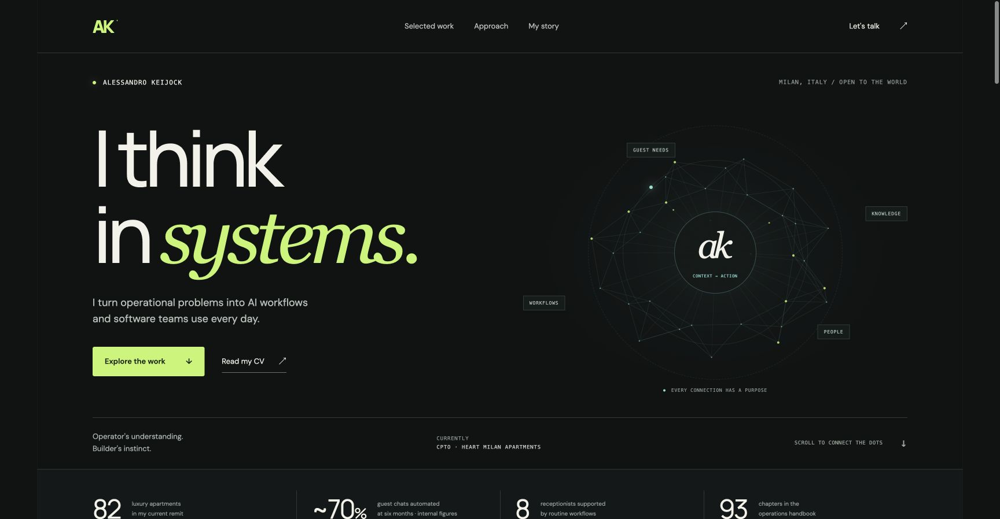

# Alessandro Keijock
### Applied AI · Workflow Design · Operational Systems

[](https://github.com/Firepie6/applied-ai-portfolio/actions/workflows/checks.yml)

I turn operational problems into AI workflows and software that teams use every day.

I am CPTO at Heart Milan Apartments, leading product and technology across 82 luxury apartments in Milan. Previously, I progressed from Property Manager to COO at Xenia Milano, working alongside the founders as the portfolio grew from 10 to 120+ apartments.

[LinkedIn](https://www.linkedin.com/in/alessandrokeijock/) · [Website](https://www.alessandrokey.com/) · [Private site preview — owner access](https://alessandro-keijock-systems.firepie6.chatgpt.site/) · [Download CV](website/Alessandro-Keijock-CV.pdf)



## Selected work

| Project | Operating problem | My contribution |
| --- | --- | --- |
| [AI Maintenance Dispatch](case-studies/maintenance-dispatch.md) | Repeated guest conversations and task coordination | Agent configuration, required information, escalation examples, workflow design and rollout |
| [Brain](case-studies/brain.md) | Fragmented context across a large personal archive | Knowledge structure, ingestion pipelines, MCP interface and automation hooks |
| [Auto-Flip](case-studies/auto-flip.md) | Repeated vehicle-listing research | Structured ingestion, explicit scoring criteria, estimates and overnight pipeline |

## What is in this repository

- Detailed case studies with architecture diagrams, personal contribution and evidence limits.
- The complete source of this portfolio website in [`website/`](website/).
- A downloadable one-page English CV.
- A separately built [Maintenance Workflow Lab](reference-lab.md), with a runnable policy engine, twelve synthetic scenarios and automated checks.

The three case studies document existing projects. They are **not source releases** of the original operational systems. The maintenance agent runs on a third-party operations platform. Brain's personal archives and the original Auto-Flip implementation are not included. The website is runnable source, written for this portfolio.

## Inspect the logic

The [reference lab](reference-lab.md) makes workflow behavior inspectable: missing fields, urgent/uncertain classifications, staff ownership, lead acceptance, event retries and stale updates. It is a new portfolio reference build, not the deployed HMA system. It uses synthetic structured fixtures and a deterministic engine; there is no LLM, external task creation or guest messaging connected.

```sh
node --test tests/*.test.mjs
```

The suite runs on Node.js 22 and 24 in GitHub Actions. Inspect the [test source](tests/workflow.test.mjs), [CI results](https://github.com/Firepie6/applied-ai-portfolio/actions/workflows/checks.yml), [production boundaries](reference-lab.md#production-boundaries) and [evidence scope](evidence.md).

## How I work

1. Understand the actual task with the people doing it.
2. Structure the information, decisions, ownership and exceptions.
3. Configure agents, connect tools and build the missing pieces with AI-assisted development.
4. Test behavior, support adoption and inspect operating outcomes.

## Run the website

```sh
python3 -m http.server 8743 --directory website
```

Open `http://localhost:8743`. No build step or dependency installation is required.

Open `http://localhost:8743/lab/` for the interactive reference lab.

The site includes a canvas network, a maintenance workflow walkthrough, native-dialog case studies, responsive layouts, reduced-motion support and a motion toggle. There is no analytics or application backend. Google Fonts has local fallbacks.

## Professional background

| Company | Role | Dates |
| --- | --- | --- |
| Heart Milan Apartments | CPTO | December 2025–present |
| Xenia Milano | COO and Property Manager | June 2023–December 2025 |
| SoloCorse.com | Account Manager | February 2022–August 2023 |

Milan, Italy. Fluent English. Italian citizen. Open to international collaboration and relocation.

## Evidence and boundaries

Figures are project-owner-reported or internal operating figures, rather than independently audited results. Each case study identifies its scope and limitations. Company milestones describe team outcomes during my tenure. No guest records, personal archives, credentials or employer application source are published here.
