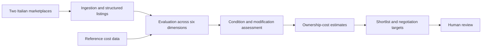

# Auto-Flip

**Type:** Personal used-vehicle market research pipeline.

**My role:** Evaluation criteria, ingestion and structured data, scoring workflow, overnight scheduling and automated tests, using AI-assisted development.

## Problem

Evaluating cars and motorcycles means reading repeated listings, comparing condition and modifications, estimating costs and deciding what deserves more attention. The pipeline converts that repeated research into a reviewable shortlist.

## Architecture overview

This is a conceptual overview. The exact six dimension names and their weights are not documented here because they have not been recovered from the original implementation.

## Output

- A structured shortlist of vehicles for further research.
- Explicit evaluation criteria.
- Condition and modification assessment.
- Estimated ownership costs based on reference data.
- Suggested negotiation targets.

The pipeline is scheduled overnight. Automated tests supported development and iteration; the original suite is not included and has not been rerun as part of publishing this case study.

## Evidence boundary

The project description establishes a research workflow, not realized trading profit or demonstrated predictive accuracy. Estimated costs and negotiation targets need review against current information before a purchasing decision. No purchasing automation is claimed.

## Publication boundary

This is documentation of an existing personal project, not a source release. No live marketplace data, original scraper, account credentials or private research database is included. Visual scores on the portfolio website are explicitly illustrative.
