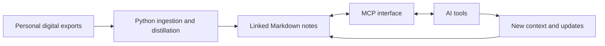

# Brain

**Type:** Personal knowledge system.

**My role:** Knowledge structure, machine-readable note conventions, Python ingestion pipelines, MCP retrieval/update interface and automation hooks, built using AI-assisted development.

## Problem

Useful context is spread across messages, conversations, photographs, email and calendars. Individual records are difficult to use unless people, projects, decisions and relationships become connected.

## Architecture overview

This is a conceptual architecture rather than an exact module-level source diagram.

## Scale

- Approximately 14,000 interconnected Markdown notes.
- Source archive includes approximately 177,000 messages spanning 12 years.
- More than 1,300 AI conversations and 93,000 photographs, alongside other exports.

These are owner-reported archive counts. They do not establish retrieval accuracy, completeness, deduplication quality or a benchmark against another system. The number of source items is not the number of notes produced.

## Design decisions

The knowledge base uses ordinary local Markdown files so its contents remain directly inspectable and portable. Linked notes and machine-readable conventions give tools structure to work with. The MCP interface allows AI tools to retrieve context and write updates; automation hooks connect ongoing work back into the archive.

## Intended uses

- Recall earlier decisions and their context.
- Prepare briefings.
- Maintain continuity across projects and relationships.

## Publication boundary

This repository documents the project. It does not contain the personal archive, source messages, photographs, private notes, MCP credentials or original implementation. No retrieval-quality study is claimed. A public synthetic-data demonstration could be added separately without exposing the underlying archive.
