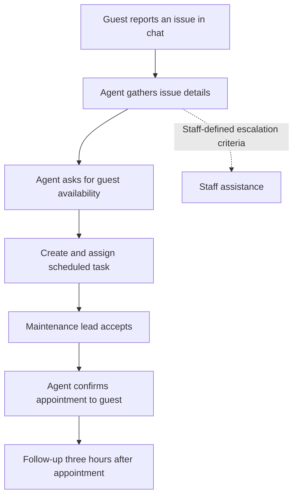

# AI Maintenance Dispatch

**Context:** Heart Milan Apartments, a hospitality operation spanning 82 luxury apartments in Milan.

**My role:** Agent and workflow configuration, operational requirements, testing and rollout. Built with the third-party operations platform's existing agent and workflow builders.

## Problem

A maintenance request combines issue interpretation, missing details, guest availability, task creation, assignment and confirmation. Staff otherwise have to connect those steps through multiple messages and manual coordination.

## Deployed flow

The diagram describes the normal flow and the intended escalation route. It is not a formal specification of the platform's enforcement or an audited state machine.

## My contribution

- Configured the agent's instructions and workflow using existing platform builders.
- Agreed required information and examples of when to escalate with the operational team.
- Tested manually through varied guest conversations.
- Connected Codex through the application API to run hundreds of simulated cases and inspect consistency.
- Established manual fallback and staff takeover procedures for outages and exceptions.
- Connected acceptance by the maintenance lead to guest confirmation.

## Operating observations

| Observation | Scope and interpretation |
| --- | --- |
| 47 live requests without reported corrective intervention | Initial operational checkpoint; no independent reliability audit or published event-level dataset |
| Approximately 30 minutes per request in an early estimate | Staff discussion and message timing; the method mixed waiting intervals with assumed writing time. Not measured active handling or time savings |
| Approximately 70% of guest-related chats automated after six months | Internal figure for the broader HMA deployment; not attributable solely to maintenance |
| Eight receptionists supported | Broader routine guest-service workflow scope |

The guest follow-up asks whether everything went well three hours after the appointment. Feedback, guest communication and calls inform operational review. The interview account does not establish a controlled guest-satisfaction or revenue uplift.

## Reliability boundaries

Escalation and non-resumption behavior were specified in agent instructions. Instruction-level guardrails do not prove an enforced workflow lock. A mandatory human-approval gate was discussed as a future improvement; it is **not claimed as deployed**.

The reported checkpoint should not be interpreted as 100% reliability, measured failure probability, or a guarantee that urgent cases cannot be missed.

## Next evaluation

1. Time active staff reading, writing and task creation, excluding waiting between messages.
2. Record human takeovers, urgent escalation misses, wrong property/task assignments and completion outcomes.
3. Test urgent cases with unclear and incomplete guest messages against staff-approved expected outcomes.
4. Pilot across different properties before wider rollout.
5. Compare similar properties in the same period to assess the effect on staff time and guest outcomes.

These are evaluation proposals rather than completed studies. No guest data, proprietary configuration or original platform code is included.

## Inspect a separate reference implementation

The portfolio now includes a [Maintenance Workflow Lab](../reference-lab.md). It demonstrates explicit staff authorization, assignment checks, event replay handling and optimistic revisions using synthetic structured cases. Its source and tests are public. This is a newly built reference artifact; it does not establish those controls in the original HMA platform.
