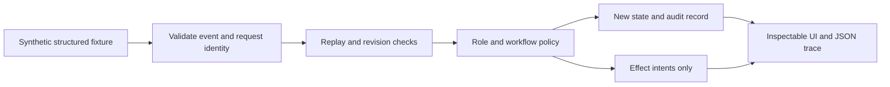

# Maintenance Workflow Lab

A runnable reference implementation built for this portfolio, separately from the deployed HMA workflow. Its purpose is to make workflow decisions inspectable and testable.

The lab uses **synthetic structured inputs and deterministic rules**. It does not call an LLM, classify guest language, connect to a property system, authenticate real users, create real tasks or send messages. It is not the original HMA implementation and is not presented as production-ready software.

## Run it

```sh
python3 -m http.server 8743 --directory website
```

Open `http://localhost:8743/lab/`. Select a scenario and inspect each event or run it to completion. The current request, action decisions, revision and proposed effects remain visible. You can download the synthetic trace as JSON.

Run the tests with Node.js 22 or newer:

```sh
node --test tests/*.test.mjs
```

There are no application dependencies to install. Node.js is needed for the test suite, not for hosting the static website.

## Architecture



`transition(state, event, catalog)` is a pure function. Successful events produce a new state and effect intents; rejected events throw a typed error and leave the supplied state unchanged. The lab never executes its effect intents.

| File | Responsibility |
| --- | --- |
| [`engine.mjs`](website/lab/engine.mjs) | Validation, ownership, task transitions, replay handling, revisions and audit |
| [`scenarios.mjs`](website/lab/scenarios.mjs) | Twelve fixed synthetic scenarios and their expected outcomes |
| [`lab.mjs`](website/lab/lab.mjs) | Case selection, step inspection, result rendering and JSON download |
| [`workflow.test.mjs`](tests/workflow.test.mjs) | Scenario outcomes and independently specified invariants |

## Reference policy

- Task creation requires a known property, non-blank issue, explicit routine classification and valid future availability.
- Explicitly urgent or uncertain urgency routes the request to staff. Unknown property identifiers do the same.
- A human-owned request cannot silently return to automation. Only a staff authorization event, with a reason and resolved urgency/property uncertainty, can release it.
- A task's assignee and appointment come from validated request data, rather than action-supplied overrides.
- Only the assigned maintenance lead can accept the task.
- Guest confirmation requires acceptance and still-valid availability.
- Material task changes are rejected. A production replanning flow would need its own lifecycle; it is not implemented here.
- Identical event replay emits no new effect intents. Reusing an event ID for different data fails.
- New events require the current revision and cannot move time backwards.

## What the checks cover

The suite covers the twelve named scenarios, required inputs, ordering permutations, actor mismatch, source-object immutability, stale workers, replay after later progress, altered event reuse, human handoff, expired availability, invalid dates and malformed inputs.

Passing these fixtures demonstrates consistency with this reference policy. It does **not** establish classifier quality, real guest outcomes, failure probability or production availability. The UTC-only fixture clock is fixed in June 2030 to keep the demonstration reproducible; it does not represent live appointment data.

## Production boundaries

The browser can choose demo actor identities and mutate its own state. Role checks here are logic checks, not authentication. A production adapter would need:

1. Server-side authentication and authorization; actor roles must come from trusted identity.
2. Durable storage and an atomic compare-and-swap on the request revision. The in-memory revision check alone cannot arbitrate concurrent servers.
3. A transactional outbox and downstream idempotency. Returned keys alone do not guarantee exactly-once delivery or execution.
4. A trusted extraction/classification layer, evaluated separately on realistic language, urgency and ambiguity.
5. Property/time-zone validation, calendar conflict handling, cancellation, replanning and completion/follow-up lifecycles.
6. Real escalation delivery, monitoring, response ownership, privacy controls and operational evaluation.

## Relationship to the deployed project

The [HMA case study](case-studies/maintenance-dispatch.md) describes what was reported as deployed and observed. In that implementation, handoff/non-resumption behavior was specified in agent instructions; an enforced staff approval gate was discussed as an improvement. This reference engine demonstrates such an explicit gate **only in the portfolio lab**. It does not retroactively establish that control in HMA production.
